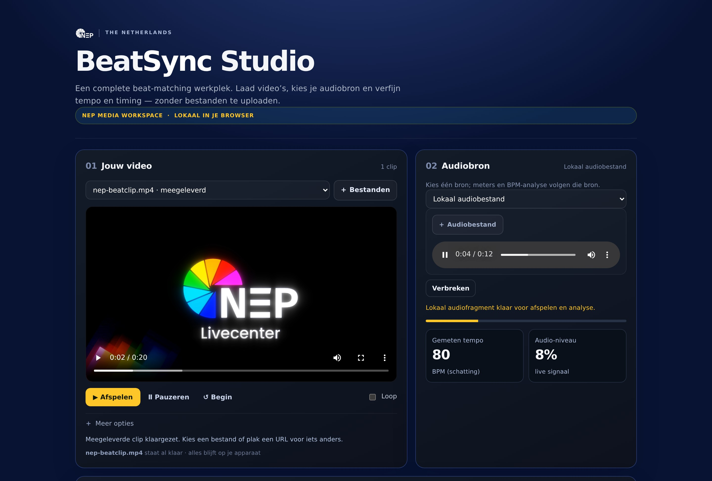
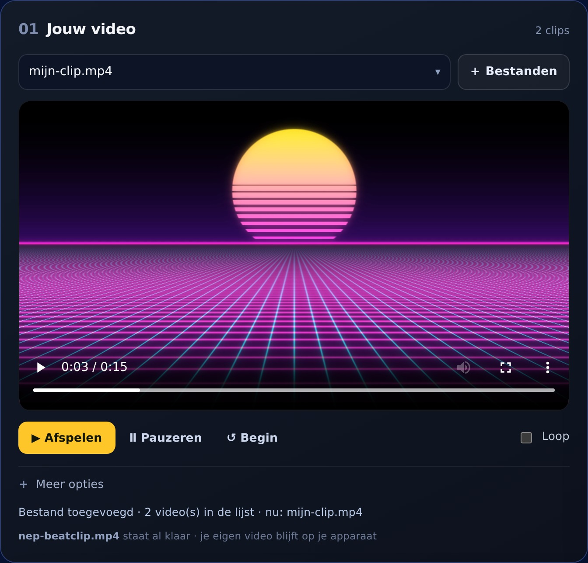
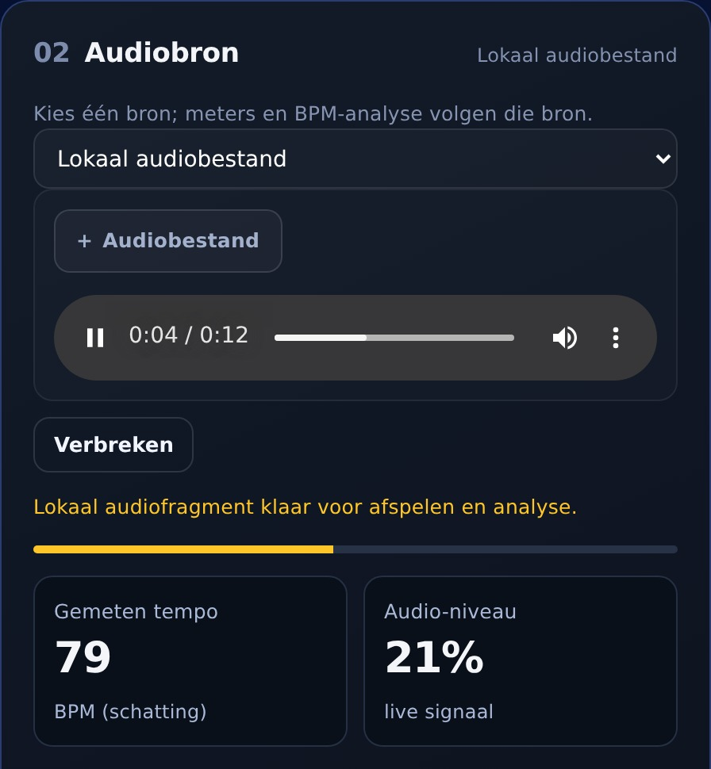
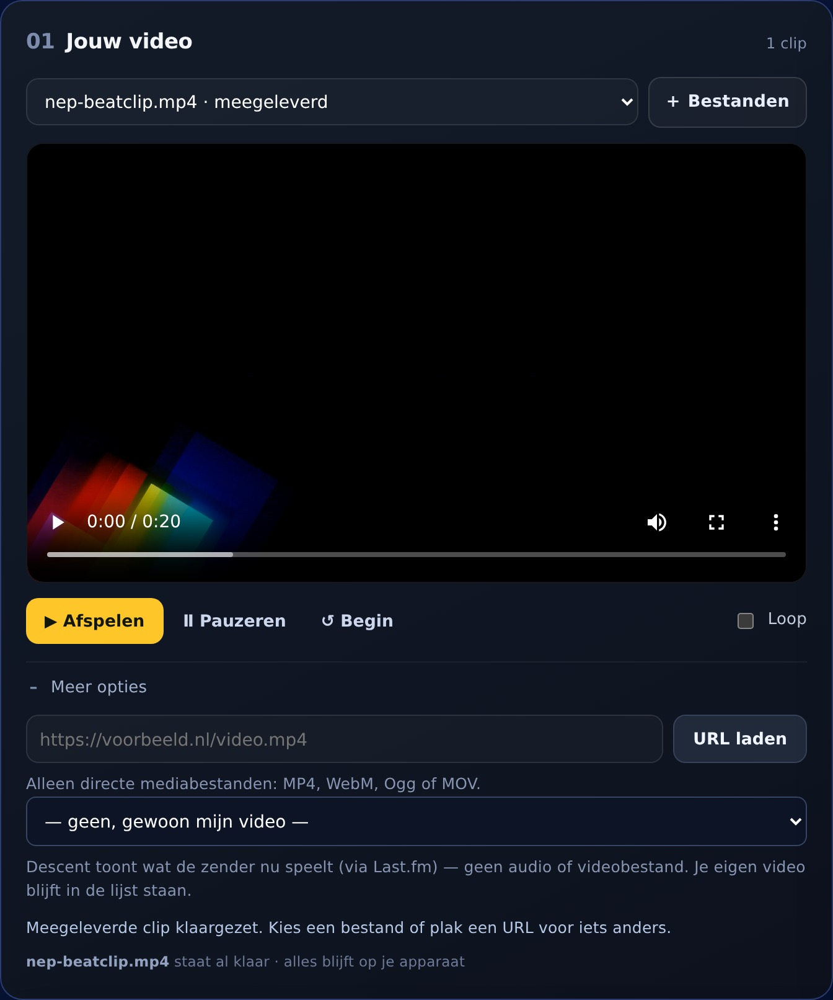
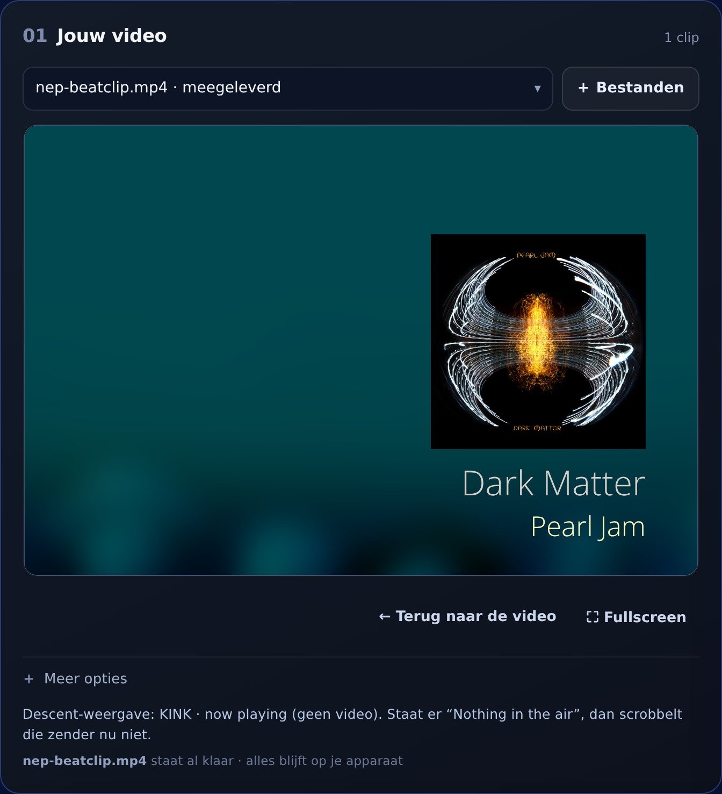
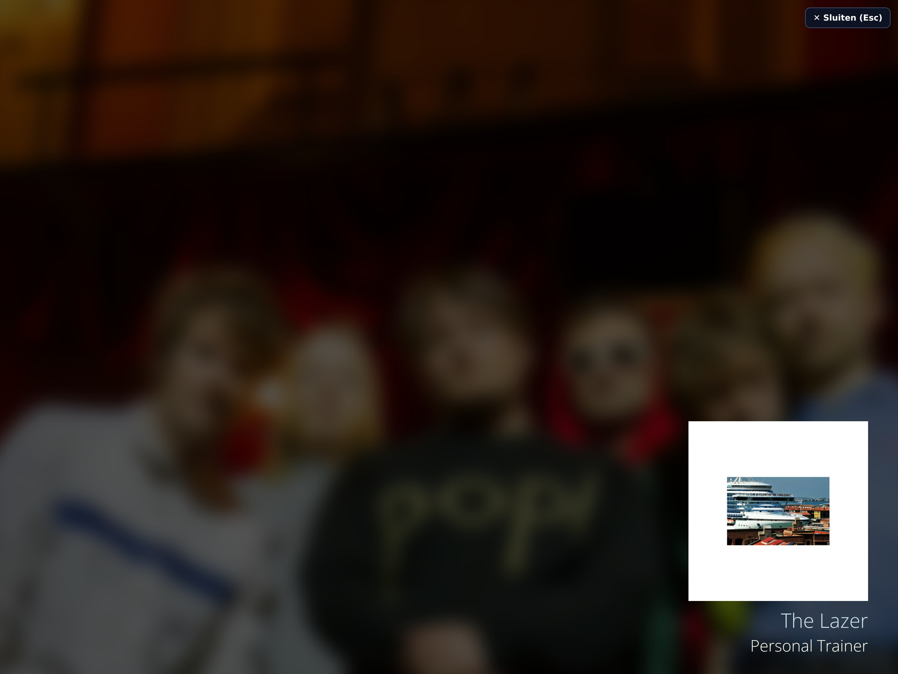
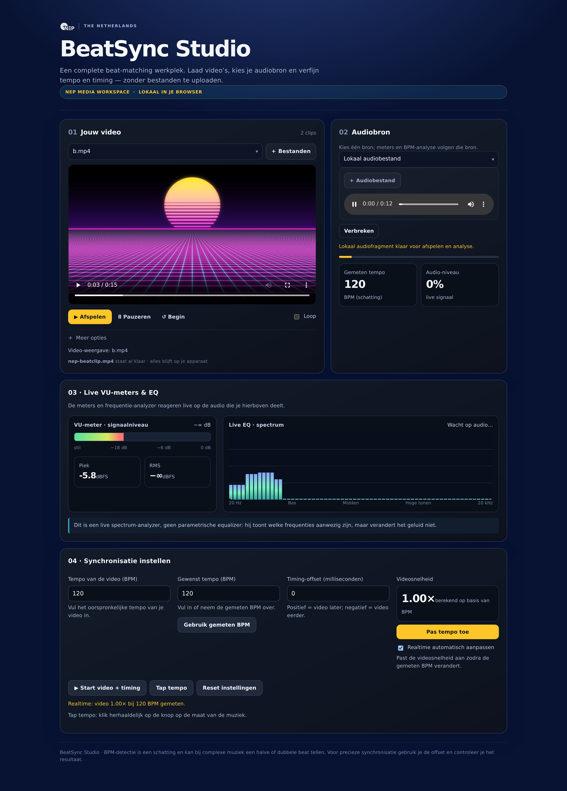

<div align="center">

# BeatSync Studio

**Video's laten meelopen met de beat — volledig in de browser.**

Meerdere video's, een eigen audiobron, live BPM-detectie en tempo-correctie in één
HTML-bestand. Niets wordt geüpload: alles draait op het apparaat van de gebruiker.

[](https://github.com/Theberas04/beatsync-studio/actions/workflows/validate.yml)
[](https://theberas04.github.io/beatsync-studio/)
[](https://theberas04.github.io/beatsync-studio/)

[**Open de live-versie →**](https://theberas04.github.io/beatsync-studio/)

[](https://theberas04.github.io/beatsync-studio/)

</div>

---

## Wat het doet

Je laadt een of meer video's, kiest een audiobron, en BeatSync meet het tempo van die
audio. Met één klik loopt de video mee: de afspeelsnelheid wordt op de BPM gezet, met een
offset in milliseconden om het beeld precies op de tel te leggen.

| | |
|---|---|
|  |  |
| **Jouw video** — voeg je eigen bestanden toe (of kies een clip uit de lijst); daaronder de afspeelknoppen en de loop-schakelaar. De video-URL en de Descent-weergave zitten achter *Meer opties*. | **Audiobron** — lokaal bestand, directe URL, ingebouwde radio of tabbladaudio. De meters en de BPM-schatting volgen de gekozen bron. |

### Meer opties: video-URL en Descent

Eén regel voor een directe link naar een videobestand, en een keuzelijst met elf
Descent-pagina's. Dichtgeklapt tot je het nodig hebt.



### Descent-weergave, ook schermvullend

Kies een zender en de now-playing-pagina verschijnt in het videogebied. Met **⛶ Fullscreen**
gaat hij over het hele scherm; **Esc** of de sluitknop brengt je terug, **← Terug naar de
video** zet je eigen video weer neer.

|  |  |
|---|---|

### De hele app

[](https://theberas04.github.io/beatsync-studio/)

## Functies

- **Video's**: eigen bestanden kiezen, een directe video-URL plakken, of de meegeleverde clip gebruiken — alles in één keuzelijst.
- **Descent-weergave als beeld**: 11 now-playing-pagina's (Qmusic, KINK, KINK Distortion, JOE, Music Starts Here, NPO Radio 2, Radio 10, Sky Radio, Veronica, SLAM!, NPO Radio 2 Soul & Jazz) openen in het videopaneel, met **fullscreen** (knop, of Esc om te sluiten) en één klik terug naar je video.
- **Audiobron** via een dropdown:
  - lokaal audiobestand
  - directe audio-URL
  - ingebouwde browser met radiowebsites (o.a. radiozenders.fm en nederland.fm)
  - audio van een ander browsertabblad delen
- **Live VU-meter** met piek- en RMS-waarde in dBFS.
- **Live spectrum-analyzer** (EQ-weergave).
- **BPM-schatting** met adaptieve beat-detectie, plus tap-tempo.
- **Tempo-correctie**: videosnelheid op basis van BPM, met timing-offset en automatische modus.

## Gebruik

1. Open de [live-versie](https://theberas04.github.io/beatsync-studio/) of `index.html` in Chrome of Edge.
2. Kies de meegeleverde clip, of voeg je eigen video toe met **+ Bestanden** (of plak een directe link onder **Meer opties**).
3. Kies onder **Audiobron** de bron die je wilt gebruiken.
4. Stel zo nodig BPM, offset en snelheid in.

Voor het delen van tabbladaudio kies je in de browserdialoog het tabblad waarop de muziek
speelt en zet je **Tabblad-audio delen** aan. Dit BeatSync-tabblad wordt bewust niet
aangeboden, zodat de app niet zijn eigen geluid gaat analyseren. Werkt het beste in Chrome
of Edge.

### Meegeleverde clip

`media/nep-beatclip.mp4` hoort bij de site en staat bij het openen al in de keuzelijst
(met het label *meegeleverd*). Het is een NEP-ident van 14 seconden, 1920×1080, H.264.
Op de container hoort hij in `/var/www/beatsync/media/` te staan; `update-from-github.sh`
zet hem daar met een sha256-controle en ruimt bestanden op die niet meer in de repo staan.

### Video via een URL

Plak een directe link naar een videobestand (MP4, WebM, Ogg, MOV) in het URL-veld en klik
op **URL laden**.

- Werkt: links die direct een mediabestand opleveren, ook als de host geen CORS-headers
  stuurt — afspelen vereist geen CORS.
- Werkt ook: meerdere URL's naast lokale bestanden; ze staan samen in de keuzelijst.
- Werkt niet: een YouTube-, Vimeo- of andere **webpagina**-link. Dat is geen videobestand,
  dus de browser kan hem niet laden — de app meldt dat dan ook. Een link achter een login
  of met een 403 geeft hetzelfde probleem.

## Beperkingen

- BPM-detectie is een schatting; bij complexe muziek kan er een halve of dubbele beat
  worden geteld. Gebruik de offset om bij te sturen.
- De spectrum-analyzer toont frequenties maar verandert het geluid niet.
- Bronnen zonder direct audiobestand (beveiligde streamingdiensten) kunnen niet
  rechtstreeks worden uitgelezen; gebruik daar de optie om tabbladaudio te delen, mits de
  browser dat toestaat.
- Van YouTube-video's kan de audio niet door de pagina worden geanalyseerd; daarom is
  YouTube-ondersteuning in deze versie verwijderd.

## Installeren op Proxmox met één commando

Op de Proxmox-host als root:

```bash
bash <(curl -fsSL https://raw.githubusercontent.com/Theberas04/beatsync-studio/main/deploy/proxmox/install.sh)
```

Het script maakt een Debian LXC-container (DHCP), installeert nginx en zet de site klaar.
Meer opties en probleemoplossing: [`deploy/proxmox/README.md`](deploy/proxmox/README.md).

### Bestaande container bijwerken

```bash
bash <(curl -fsSL https://raw.githubusercontent.com/Theberas04/beatsync-studio/main/deploy/proxmox/update-from-github.sh) 103
```

Haalt `index.html` én alle bestanden uit `media/` op, maakt een backup en controleert per
bestand de sha256. Tweede keer draaien verandert niets.

## Publiek bereikbaar (Cloudflare Tunnel)

Zet de site op een hostname zonder open poorten:

```bash
./add-cloudflare-tunnel.sh <container-id>
```

Diagnose en probleemoplossing (redirect-lus, certificaatdekking, origin-instellingen):
[`deploy/proxmox/README.md`](deploy/proxmox/README.md).

## Projectstructuur

```
index.html                     de hele app: HTML, CSS en JS in één bestand
media/nep-beatclip.mp4         meegeleverde clip
docs/screenshots/              beelden voor deze README
deploy/proxmox/install.sh      one-liner installatie
deploy/proxmox/update-from-github.sh   site + media bijwerken in een bestaande container
deploy/proxmox/check-tunnel.sh diagnose van de Cloudflare-route
deploy/proxmox/fix-loop.sh     redirect-lus achter een tunnel repareren
.github/workflows/validate.yml CI: JS-syntax, HTML-controles, shellscripts
```

## Licentie

Geen licentiebestand toegevoegd; het project is in eigen beheer.
